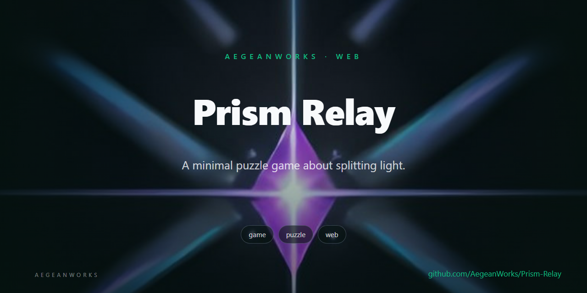
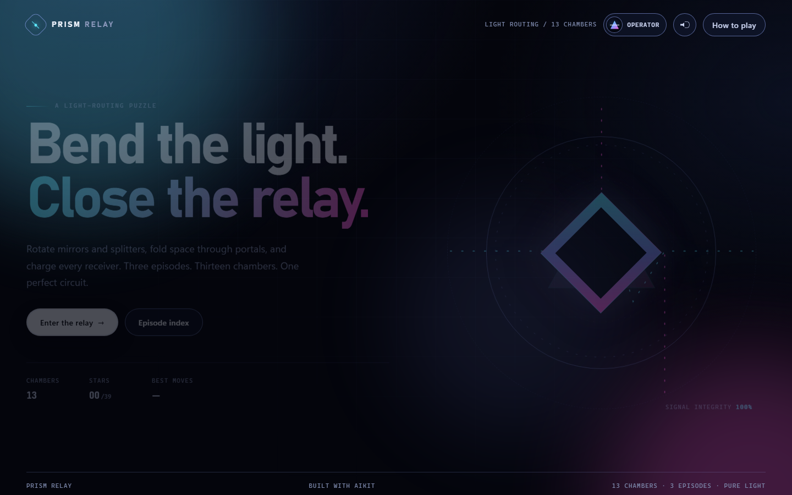

# Prism Relay

<!-- aegean:media:start -->
<p align="center"></p>
<!-- aegean:media:end -->

[](https://github.com/AegeanWorks/AIKit)

A neon light-routing puzzle game: rotate mirrors and splitters, split beams through prisms, fold space through portals, and charge every receiver across three episodes.

## 30-Second Cold-Start Quick Reference

- **Runtime Prerequisites**: Node.js 20+ (tested on Node 26) and a modern browser (Chromium, Firefox or Safari). No npm install and no network access are required.
- **Play locally (one click)**: double-click `play.cmd` on Windows, run `./play.sh` on macOS/Linux, or run `npm start`. Each starts the server and opens the game at `http://127.0.0.1:4173/`; keep that address so your saved progress stays available.
- **Do not open `index.html` directly.** Browsers block ES modules from `file://`, so the page renders but the Play button does nothing. Use a launcher above.
- **Canonical Regression Shield Gate**:
  ```bash
  npm test
  ```
- **UI inventory proof**:
  ```bash
  npm run ui:snapshot
  ```

### Controls

| Input | Action |
|---|---|
| Click / tap a mirror or splitter | Rotate it 90 degrees |
| Arrow keys | Move focus between rotatable pieces |
| Space / Enter | Rotate the focused piece |
| R | Restart the chamber |
| P | Open or close the operator profile |
| Esc | Pause |
| M | Mute or unmute all audio |

## What Is Prism Relay

Each chamber is a grid of emitters, mirrors, splitters, prisms, portals and receivers. An emitter fires a continuous beam. A mirror reflects the beam; a splitter keeps the main beam and forks a copy to one side; a prism passes the beam through and splits copies to both perpendicular sides; a paired portal carries the beam across the grid in the same direction. A receiver absorbs the beam and charges. Charge every receiver to close the relay.

Moves are counted per rotation. Each chamber advertises a par, the shortest possible solution. Finish at or under par for three stars, within two extra moves for two, and otherwise one. The best rating and move count for every chamber are saved locally.

### Episodes and Chambers

| Episode | Chambers | Mechanic | Arc |
|---|---|---|---|
| I — Ignition | 01–06 | Mirrors and fixed prisms | Learn the relay, then close a six-chamber vault |
| II — Refraction | 07–10 | Rotatable splitters | Fork the signal and keep every branch alive |
| III — Crossing | 11–13 | Paired teleport portals | Fold space and finish the longest circuit |

Every episode ends with a larger, harder finale. Par rises from 1 move in First Light to 13 moves in The Long Way Home.

### Operator Profile and Audio

The profile stores a callsign (up to 18 characters), one of four sigils, rank, chamber and star totals, perfect routes, total best moves, per-episode progress, and audio preferences. Rank climbs from Cadet through Operator, Weaver, Architect and Lumen to Relay Master at all 39 stars.

Music and effects are generated at runtime with WebAudio; there are no audio files. Music begins after the first user gesture, respects the browser autoplay policy, pauses when the tab is hidden, and can be toggled independently from effects in the profile or muted together with M.

Progress is stored in `localStorage` under `prism-relay.progress.v1`. A missing or corrupt record resets safely; an older record without profile, music or episode fields keeps its stars and gains defaults. Sequential unlocks are repaired from completed chambers, so a save that finished Ignition opens Refraction automatically.

## What's Inside

```text
prism-relay/
├── .aikit/                    <- project memory: record, ledger, decisions, UI contract
├── .gitattributes             <- CRLF for .cmd and LF for .sh launchers
├── .gitignore                 <- transient state and caches excluded
├── COMMERCIAL.md              <- commercial licensing and enterprise agreement
├── LICENSE                   <- Aegean Game License 1.1 (AGL-1.1): DRM-free personal play
├── LICENSES/                 <- REUSE license texts
├── REUSE.toml                <- Machine-readable SPDX metadata
├── CHANGELOG.md              <- Version history and license transition
├── ASSETS.md                 <- Asset/data manifest: what the license covers
├── README.md                  <- this living quick reference
├── index.html                 <- semantic shell and all four UI screens
├── package.json               <- zero dependencies, test and snapshot commands
├── play.cmd                   <- Windows one-click launcher: serve and open
├── play.sh                    <- macOS/Linux one-click launcher: serve and open
├── scripts/
│   ├── serve.mjs              <- static server with --open and port-in-use recovery
│   └── ui-inventory.mjs       <- stable data-ui / data-panel / data-cue inventory
├── src/
│   ├── game/
│   │   ├── engine.js          <- parser, beam tracer, splitters, portals, sessions
│   │   ├── levels.js          <- three episodes and thirteen frozen ASCII chambers
│   │   └── solver.js          <- exhaustive minimum-move solver over all rotatables
│   ├── ui/
│   │   ├── app.js             <- screens, board renderer, profile, input, dialogs
│   │   ├── audio.js           <- generated effects and ambient music, no assets
│   │   └── progress.js        <- versioned saves, profile, rank and statistics
│   ├── styles.css             <- component styling using theme tokens
│   └── theme.css              <- the only file with raw color and font values
└── tests/
    ├── engine.test.js         <- physics, splitters, portals, sessions, pars
    ├── progress.test.js       <- saves, profile, rank, unlocks, audio settings
    ├── server.test.js         <- path containment, traversal refusal, launcher helpers
    └── ui.test.js             <- screen, control and manifest contract
```

### Design Decisions

- **Pure engine first.** `engine.js` knows nothing about the DOM. `traceBeams` returns immutable paths and lit-receiver keys, so tests and the SVG renderer share one source of truth.
- **Solver-backed par.** Every chamber is checked at test time by enumerating every two-state rotatable, including splitters. The advertised par must equal the true minimum move count.
- **Segmented portal paths.** A portal ends one beam segment and starts another at its twin, so the renderer never draws a false line across unrelated tiles.
- **Additive saves.** The save version stays at 1. New fields are optional and normalized, while sequential unlocks are reconstructed from completed chambers instead of discarding old progress.
- **Token-only styling.** Raw colors and font values live in `src/theme.css`; every other line uses CSS custom properties.
- **Accessible by construction.** The board is a group of real buttons with labels, roving keyboard focus, a live status line and a native `<dialog>`; buttons and topbar controls meet 3:1 boundaries and 44px coarse-pointer targets, while dense board cells stay at least 24px.
- **No external assets.** Light beams are SVG paths, pieces are CSS shapes, and all audio is synthesized with WebAudio after a user gesture.

## AIKit Workflow

Run these from the AIKit checkout:

| Role | Command |
|---|---|
| Project status, task and gates | `python aikit.py status prism-relay` |
| Open a bounded UI task | `python aikit.py ui begin prism-relay --surface app` |
| Verify scope, fast proof, inventory and style drift | `python aikit.py ui verify prism-relay` |
| Close the UI task after review | `python aikit.py ui finish prism-relay --reviewed --reviewer <name>` |
| Phase 4: every gate | `python aikit.py check prism-relay` |

The committed UI contract `.aikit/ui.json` bounds the surface to `index.html` and `src/**`, runs `npm test` as the fast proof, and compares `npm run ui:snapshot` against the baseline. Tests, tooling, project memory and README are protected paths. A feature pass that also changes the engine, tests or memory uses the project gates directly instead of opening a UI-only task.

### Screenshot QA

The app accepts development-only query parameters so every state can be captured without a test driver:

| URL | State |
|---|---|
| `/?screen=title` | Title |
| `/?screen=chambers` | Episode and chamber index |
| `/?screen=profile` | Operator profile |
| `/?level=double-down` | Splitter gameplay (Episode II) |
| `/?level=twin-gates` | Portal gameplay (Episode III) |
| `/?level=wormhole&preview=howto` | How-to dialog |
| `/?level=wormhole&preview=pause` | Pause dialog |
| `/?level=the-vault&preview=victory` | Episode-complete victory dialog |

Screenshots are reviewed by independent model-provider subagents before the final UI commit; a vision-capable reviewer verifies the final pass. Screenshot files and the review brief live in the local, git-ignored `.review/` folder.

<!-- aegean:brand-assets:start -->
## 🎨 Brand Assets

> **AI-Generated Brand Artwork.** The banner and logo are **AI-generated brand assets**. They are illustrative and may not literally depict every feature or the full project scope.
<!-- aegean:brand-assets:end -->

## 📜 License

Free for personal play under the Aegean Game License 1.1 (AGL-1.1); see [LICENSE](LICENSE). It is DRM-free: Licensor ships no DRM and a distributor may not add it. Streaming, modding and free mods are allowed. Commercial use, paid mods and AI training need the Aegean Commercial License 1.0 (ACL-1.0); see [COMMERCIAL.md](COMMERCIAL.md).

<!-- aegean:screenshots:start -->
## Screenshots

<a href="https://github.com/AegeanWorks/Prism-Relay/commit/de3c997"></a>

*commit `de3c997` · 2026-10-28*
<!-- aegean:screenshots:end -->
